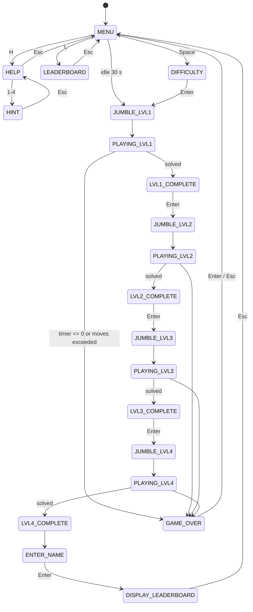

# Mosaic Master

A tile-swap jigsaw puzzle game written in **Monkey X** (Mojo framework) for the OCR A Level Computer Science (H446) NEA by Parv Shah.

The player unjumbles four mosaic-style images by swapping pairs of tiles, against a global countdown and per-level move limits. Total moves become the score, which is saved to a persistent leaderboard.

Target audience: children aged 7-10. Design priorities are large text, a high-contrast primary-colour palette, audio feedback and simple controls.

---

## Contents

- [Features](#features)
- [Tech stack](#tech-stack)
- [Controls](#controls)
- [Architecture](#architecture)
- [Core algorithms](#core-algorithms)
- [Data and persistence](#data-and-persistence)
- [Assets](#assets)
- [Build and run](#build-and-run)
- [Testing](#testing)
- [Known issues and limitations](#known-issues-and-limitations)
- [Credits](#credits)

---

## Features

| Feature | Notes |
| --- | --- |
| 4 progressive levels | 2x2, 3x3, 5x5 and 6x6 grids (4, 9, 25 and 36 tiles) |
| Tile swap mechanic | Click one tile to select it, then click a second to swap |
| Difficulty selector | Sets how many random swaps are applied when the board is jumbled |
| Global countdown timer | One 120 s timer shared across all levels |
| Move counter | Per level, resets each level; exceeding the cap triggers Game Over |
| Score | Cumulative moves across all levels (lower is better) |
| Help screen and hint system | `H` opens help, then `1`-`4` previews each solved image |
| Leaderboard | Name entry after level 4, scores persisted to a text file and sorted ascending |
| Game Over state | Triggered by timer expiry or move limit |
| Level complete screens | Solved image shown as an overlay between levels |
| Audio | Menu/level background music plus swap and level-complete sound effects |

---

## Tech stack

| Component | Detail |
| --- | --- |
| Language | Monkey X (object-oriented, case-sensitive, BASIC-like syntax) |
| Framework | `mojo` (graphics, audio, input) |
| Targets | Desktop (GLFW3) or HTML5 |
| Resolution | 900x900 (originally 500x500, scaled by a factor of 1.8) |
| Image format | `.png`, with images prepared in Photopea and MS Paint |
| Audio format | `.ogg` (converted from `.mp3` because Monkey X supports Ogg) |
| Storage | Plain-text files via `FileStream` |

---

## Controls

| Key / input | Context | Action |
| --- | --- | --- |
| `H` | Menu | Open help screen |
| `1`-`4` | Help screen | Show the solved image for that level (hint) |
| `L` | Menu | Open leaderboard |
| `Space` | Menu | Go to difficulty selection |
| `1`-`3` | Difficulty screen | Choose difficulty (1 easy, 3 hard) |
| `Enter` | Difficulty / level complete / Game Over | Confirm and continue |
| Left mouse button | Playing | Select a tile, then click a second tile to swap |
| Keyboard | Name entry | Type name, `Backspace` to delete, `Enter` to submit |
| `Esc` | Sub-screens / playing | Return to previous screen or menu |
| `O` | Menu | Developer shortcut that forces the Game Over state for testing |

If the player idles on the menu for 30 s, the game force-starts level 1.

---

## Architecture

The game follows the standard Mojo `App` lifecycle, with state held in a single `GameState` string.

| Method | Responsibility |
| --- | --- |
| `OnCreate()` | Set update rate, seed the RNG, load images and sounds, extract tiles, initialise arrays |
| `OnUpdate()` | All game logic: input handling, state transitions, jumbling, swap, timer and move checks |
| `OnRender()` | All drawing, with one branch per game state |

### State machine



### Classes

**`Level`** is a single class instantiated once per level, replacing the earlier copy-pasted per-level variables.

```
Class Level
    puzzle, square, square_selected, solvedPic : Image
    tile1[4], tile2[9], tile3[25], tile4[36]   : Image[]
    selected : Int = -1                         ' -1 means no tile selected

    Method New(level_num)                       ' loads Puzzle<n>.png, square<n>.png, selected<n>.png
    Method load1() .. load4()                   ' slice puzzle image into tiles, initialise board
    Method Draw1() .. Draw4()                   ' render grid, selection highlight, borders
End
```

The constructor takes `level_num` and builds asset filenames from it (`"Puzzle" + level_num + ".png"`), so adding a level means a new `Level(n)` plus its `loadN`/`drawN` methods.

**`GameScore`** is a small record-like class (`score:Int`, `name:String`) used to hold leaderboard entries in an array.

### Key data structures

| Name | Type | Purpose |
| --- | --- | --- |
| `board1[]` ... `board4[]` | `Int[]` | Logical layout: `board[pos]` holds which tile index currently sits at grid position `pos`. Starts solved (`board[i] = i`), then is shuffled |
| `tile[]` | `Image[]` | Image slices grabbed from the source puzzle image, never reordered |
| `difficulty` | `Int` | Number of random swaps applied when jumbling |
| `MAXTIME` | `Int` | Reference start time (ms) for the global countdown |
| `Moves1`...`Moves4` | `Int` | Per-level move counters |
| `TOTALMOVES` | `Int` | Cumulative moves, used as the final score |
| `PlayerScore[]` | `GameScore[]` | In-memory leaderboard loaded from file |

Separating `board` (logic) from `tile` (images) means swapping is just an integer swap, and rendering looks up `tile[board[pos]]`.

---

## Core algorithms

### 1. Tile extraction

Each puzzle PNG is cut into `n x n` tiles with `GrabImage` inside a loop, and `board[i]` is set to `i` so the board starts in the solved state.

### 2. 2D to 1D indexing

The grid is stored in a flat array. A mouse position maps to a board index by integer division:

```
x = MouseX / tileSize
y = MouseY / tileSize
index = y * gridWidth + x
```

Tile size is `900 / n`, giving 450, 300, 180 and 150 px for levels 1-4. The same formula is used in reverse for drawing, which is why the 500 px version needed 250, ~166, 100 and ~83 px tiles (non-integer for odd divisors, one reason for moving to 900 px).

### 3. Jumbling

```
Seed = Millisecs()                      ' otherwise the shuffle is identical every run
For counter = 0 To difficulty
    a = Rnd(0, tileCount)
    b = Rnd(0, tileCount)
    swapN(a, b)
Next
GameState = "PLAYING LVLn"
```

Because the board is shuffled using only valid swaps from the solved state, every puzzle is guaranteed to be solvable. Higher difficulty means more swaps, so the board ends up further from solved on average.

### 4. Selection and swap

```
If MouseHit(MOUSE_LEFT)
    PlaySound(swapSound)
    index = (MouseY / tileSize) * n + (MouseX / tileSize)
    If puzzle.selected = -1
        puzzle.selected = index              ' first click
    Else
        swapN(puzzle.selected, index)        ' second click
        puzzle.selected = -1
        MovesN += 1
    End
End
```

`swapN` is a standard three-step temp-variable swap on `boardN`.

### 5. Solved check

```
Function solvedN:Bool()
    For i = 0 Until tileCount
        If boardN[i] <> i Then Return False
    Next
    Return True
End
```

Linear scan, O(n) with n of 4, 9, 25 or 36. Checked every update while the level is playing.

### 6. Timer and Game Over

One global countdown covers all four levels (120 s). Early versions used a separate timer per level, but a single function called from outside the level states stops it resetting between levels. Game Over fires on `timeRemaining <= 0` or when the level's move count exceeds its cap. An early bug used `= 0`, which only matched for a single frame, so the check was changed to `<=`.

### 7. Scoring

`TOTALMOVES` accumulates each level's move count when that level completes. Lower is better. It must not be reset at the end of a level, because that wiped the score before it reached the leaderboard (fixed in development).

### 8. Leaderboard insertion

Scores are held in a sorted array and file. On a new score the game finds the first position where the new score beats the existing one, shifts lower entries down one slot, drops the last entry, and writes the array back to the rank file.

```
For row = 4 Until 0 Step -1
    PlayerScore[row] = PlayerScore[row - 1]
Next
PlayerScore[count] = new entry
```

The comparison is `<` (fewer moves ranks higher). An earlier `>` produced descending order, which was wrong for a lowest-is-best score.

---

## Data and persistence

Leaderboard data is stored in plain text, one record per line as `score,name`.

| File | Mode | Role |
| --- | --- | --- |
| `score_File.txt` | Append | Raw log of every submitted score and name |
| `rank.txt` | Read / rewrite | Sorted top scores, loaded into `PlayerScore[]` |

- `writeNameAndScore(name, score)` opens the score file in append mode, writes `score,name`, and closes it.
- `LoadRanking()` reads the whole rank file into a string, splits on newlines, then splits each line on commas into `mark` (score) and `name`.
- `UpdateScore(name, score)` performs the insertion above and rewrites the rank file.
- Name entry rejects empty names, so no blank score is stored, and a length limit keeps leaderboard rows tidy.

---

## Assets

Images and sounds live in the Monkey X `.data` folder alongside the source.

| Asset | Naming | Notes |
| --- | --- | --- |
| Puzzle images | `Puzzle1.png` ... `Puzzle4.png` | 900x900, mosaic-filtered in Photopea |
| Grid overlays | `square1.png` ... `square4.png` | Tile borders sized per level |
| Selection highlight | `selected1.png` ... `selected4.png` | Green outline on the selected tile |
| Screens | menu, help, difficulty, enter name, leaderboard, Game Over, level complete | Hand-made in MS Paint |
| Audio | background music, swap click, level-complete jingle | `.ogg` |

Filenames are built dynamically by `Level.New`, so a stray space in `".png"` or a typo such as `sqaure1` breaks drawing and can cause memory access violations in Monkey X. Both happened during development and are worth checking first if images fail to appear.

---

## Build and run

1. Install **Monkey X** and open the project's `.monkey` file in the Monkey X IDE (Ted).
2. Make sure the `.data` folder with all images and audio sits next to the source file.
3. Pick a target in the IDE:
   - **Desktop Game (GLFW3)** for a standalone Windows build.
   - **HTML5 Game** for browser play.
4. Build and run.

**Before running:** the leaderboard functions currently open the score and rank files using absolute paths from the development machine. Update those paths to your own `.data` location, or switch them to a relative `"monkey://data/..."` style path.

Minimum spec is modest: any machine with OpenGL support (Windows 7 or later), about 1 GB RAM, a keyboard, a mouse and audio output. The game itself is only around 20 KB of code.

---

## Testing

Testing covered black-box and white-box approaches across development, alpha, beta and post-development stages.

| Stage | Method | Outcome |
| --- | --- | --- |
| Development | 16-case test plan covering menu, navigation, tiles, score, timer, Game Over and name entry | Core behaviour passed |
| Alpha | 14 tests with valid, invalid and boundary data | Fixed leaderboard ordering and timer consolidation; flagged score reset and arrow-key swap |
| Beta | Stakeholder questionnaire, 14 checks | All functions confirmed. Feedback led to a 4th level, larger resolution and a refreshed UI |
| Post-development | Success-criteria evaluation with recorded video evidence and an invalid-input robustness table | See below |

Success criteria summary: fully met for help, hints, moves, timer, audio, leaderboard, score, four levels, menu, mouse interaction, difficulty, level complete and resolution. Partially met for Game Over. Not met for arrow-key controls.

---

## Known issues and limitations

- **Game Over timing:** the timer-expiry Game Over appears a few seconds after the countdown hits zero rather than instantly.
- **No arrow-key controls:** keyboard swapping only worked vertically and was abandoned, so the game is mouse-only.
- **Hard-coded file paths** for leaderboard files (see [Build and run](#build-and-run)).
- **Plain-text storage:** scores and names are unvalidated text, and a comma in a name would corrupt the `score,name` split.
- **Per-level duplication:** swap, solved, load and draw logic is still repeated per level (`swap1`...`swap4`, `solved1`...`solved4`). A fully generic `Level` method taking grid size as a parameter would remove this.
- **Resolution-bound layout:** tile sizes are hard-coded multiples of 900, so another resolution means editing every level.
- **Difficulty feedback:** harder difficulty only means more swaps, which is not always visible to the player.
- **Not implemented:** AI opponent, tile-swap animations and additional levels, which were cut because of time and complexity.

---

## Credits

- Original puzzle-game tutorial source by [craigndave.org](https://craigndave.org), which this project extends.
- Image editing: [Photopea](https://www.photopea.com/) and MS Paint.
- Audio conversion: [online-convert.com](https://audio.online-convert.com/convert/mp3-to-ogg), from sound sources credited in the NEA write-up.
- Full analysis, design, development log, testing and evaluation are in the accompanying NEA report (`H446 Coursework Report`).

> Submitted as OCR A Level Computer Science (H446) coursework.
